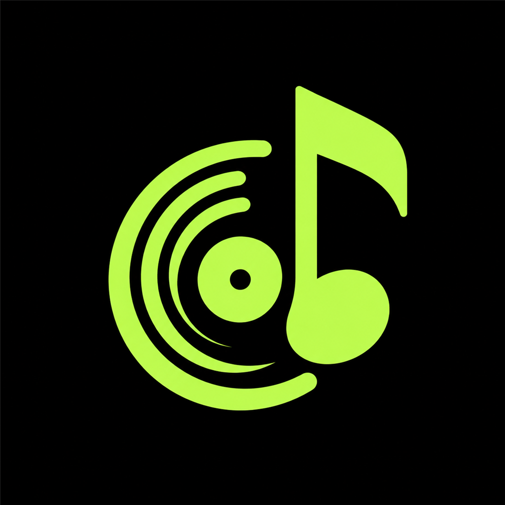

<div align="center">



# Muzik Belesh

**Your music. On your iPhone. Offline.**

A native, local-first iOS music player with a persistent music library, background playback, and optional YouTube audio importing. Designed for personal use, with no mandatory account or backend.

[](https://github.com/T-h07/MuzikBelesh/releases/latest)
[](https://github.com/T-h07/MuzikBelesh/actions/workflows/ci.yml)


**[Download v1.0.0](https://github.com/T-h07/MuzikBelesh/releases/tag/v1.0.0)** · **[Unsigned IPA](https://github.com/T-h07/MuzikBelesh/releases/download/v1.0.0/OFFLINE-unsigned.ipa)** · **[Installation guide](Docs/SIDELOADING.md)**

</div>

---

## Overview

Muzik Belesh keeps your music on your device. Import audio files through Files, organize your collection into playlists and albums, and listen without a network connection. When you want new music, the app can search supported YouTube content, inspect audio formats, and queue a download for offline playback.

The player is built with **SwiftUI and AVFoundation**, using **SQLite/GRDB** for persistent library data. It supports native **Lock Screen / Control Center** and **AirPods / Bluetooth** media controls.

## Features

| Playback | Your library |
| --- | --- |
| Offline audio and background / Lock Screen playback | Playlists, likes, albums, and artists |
| Play, pause, seek, shuffle, and repeat | Local search and seven sorting options |
| Persistent queue, listening history, and sleep timer | Editable titles, artists, albums, and artwork |
| AirPods / Bluetooth controls and audio interruption recovery | Duplicate detection, Files import/export, safe deletion |

| YouTube and downloads | Native iOS integration |
| --- | --- |
| Search, video details, and supported URL imports | Share links directly from YouTube or Safari |
| Quality choices: Data Saver, Balanced, Best Available | Persistent Share extension inbox |
| Download queue with progress, cancellation, and retry | Downloads managed through background URLSession |
| Wi-Fi-only preference with optional cellular downloads | Low Power Mode and thermal-aware work scheduling |

A persistent mini-player and full-screen Now Playing interface keep playback accessible across **Home, Search, Library, and Downloads**.

## Install on iPhone

> [!IMPORTANT]
> The release provides an **unsigned IPA** for personal **SideStore** installation. It is **not** an App Store build. SideStore must sign the main app and the Share extension using your compatible signing identity.

1. Open the **[latest GitHub Release](https://github.com/T-h07/MuzikBelesh/releases/latest)**.
2. Download `OFFLINE-unsigned.ipa` (and optionally `OFFLINE-build-manifest.json` to verify provenance).
3. Open the IPA with **SideStore**, sign it, and install on your iPhone.
4. Launch Muzik Belesh. Import existing audio from Files, or search for supported media and download audio for offline listening.

**Updating?** Install the new IPA **over the existing app**, using the same SideStore signing identity. **Do not uninstall first**—doing so may delete your local music library.

[Full sideloading instructions](Docs/SIDELOADING.md) · [Release checksums and details](https://github.com/T-h07/MuzikBelesh/releases/tag/v1.0.0)

## Using YouTube sharing

1. In the YouTube app or Safari, choose **Share → Muzik Belesh**.
2. Select **Save Link**, then **Done**.
3. **Manually open Muzik Belesh** to inspect the saved link.
4. Choose an available audio quality and tap **Download Audio**.

Sharing a link does **not** automatically start a download. Apple's supported Share extension behavior does not automatically foreground the containing app.

## Performance and reliability

Version 1.0.0 includes focused hardening for long listening sessions and large libraries:

- Reduces repeated playback-clock database reads and writes.
- Reuses Now Playing artwork instead of rebuilding it on every clock tick.
- Uses linear-time queue setup and bounded recent navigation history.
- Streams file exports with integrity checks rather than loading entire audio files into memory.
- Adapts optional work to Low Power Mode and thermal pressure without interrupting normal music playback.

These are engineering improvements, **not a guarantee of a particular battery life or device temperature**.

### Verification for v1.0.0 (Build 195)

- **262** unit/integration tests in the full suite (six optional live YouTube tests skipped).
- **25** full UI tests, **5** compact-layout checks, and **1** accessibility check passed.
- **25/25** physical iPhone 13 Pro Max acceptance cases reported as passed, including in-place upgrade, offline/locked playback, Bluetooth, downloads, and library preservation.

[Full CI evidence](https://github.com/T-h07/MuzikBelesh/actions/runs/42197209510) · [Performance report](Docs/PHASE_09_PERFORMANCE.md) · [Test plan](Docs/PHASE_09_DEVICE_TESTING.md)

## Tech stack

| Layer | Technology |
| --- | --- |
| App and UI | Swift, SwiftUI, UIKit |
| Audio | AVFoundation, MediaPlayer |
| Local storage | SQLite with GRDB, managed local audio files |
| Downloads | URLSession background transfers, Network framework |
| YouTube support | YouTubeKit, validated URL and stream handling |
| Project generation | XcodeGen |
| Builds and testing | GitHub Actions on macOS, XCTest |
| Device installation | SideStore |

**Requirements:** iPhone running **iOS 17 or later**. Building from source requires macOS/Xcode; the application can be developed from Windows while GitHub Actions performs macOS builds.

## Build from source

```bash
git clone https://github.com/T-h07/MuzikBelesh.git
cd MuzikBelesh

# On macOS, with Xcode and XcodeGen installed:
xcodegen generate
xcodebuild -resolvePackageDependencies -project OFFLINE.xcodeproj -scheme OFFLINE
xcodebuild -project OFFLINE.xcodeproj -scheme OFFLINE \
  -configuration Debug \
  -destination 'generic/platform=iOS Simulator' \
  CODE_SIGNING_ALLOWED=NO build
```

For simulator test runs and the verified arm64 unsigned IPA packaging process, see [Build pipeline](Docs/BUILD_PIPELINE.md). The source app target is `OFFLINE`; the Share extension target is `OFFLINEShareExtension`.

## Branches and development

The repository keeps three long-lived branches:

| Branch | Purpose |
| --- | --- |
| [`main`](https://github.com/T-h07/MuzikBelesh/tree/main) | Stable repository baseline |
| [`develop`](https://github.com/T-h07/MuzikBelesh/tree/develop) | Default branch; ongoing integration |
| [`release`](https://github.com/T-h07/MuzikBelesh/tree/release) | Validated stable releases and tags |

Development took place on short-lived feature branches, integrated through pull requests. **Completed feature branches can be deleted without deleting their merged commits or pull-request history.**

## Documentation

- [Project roadmap](Docs/ROADMAP.md) and [contributing](CONTRIBUTING.md)
- [v1.0 feature acceptance matrix](Docs/PHASE_09_FEATURE_MATRIX.md)
- [Library architecture](Docs/LIBRARY_ARCHITECTURE.md) and [playlist management](Docs/PLAYLIST_MANAGEMENT.md)
- [Metadata](Docs/METADATA_EDITING.md), [artwork](Docs/ARTWORK_MANAGEMENT.md), and [search/sorting](Docs/LOCAL_SEARCH_AND_SORTING.md)
- [Duplicate detection](Docs/DUPLICATE_DETECTION.md) and [safe deletion](Docs/SAFE_LIBRARY_DELETION.md)
- [Release audit](Docs/PHASE_09_RELEASE_AUDIT.md), [test evidence](Docs/TEST_PLAN.md), and [known limitations](Docs/KNOWN_LIMITATIONS.md)

## Known limitations

- YouTube availability and supported stream formats can change independently of the app; requests require connectivity and can occasionally time out.
- The native Share extension requires you to open Muzik Belesh manually after saving a link.
- iOS controls the scheduling of background transfers; force-quitting the app may stop pending background work.
- The distributed IPA requires personal signing through SideStore.

---

<div align="center">

**Muzik Belesh · v1.0.0**

Built for personal, offline-first listening.

</div>
